# Rapport - Workshop
**Yaëlle Dufour** - *IMAC1*

---

## 1. Ne garder que le vert
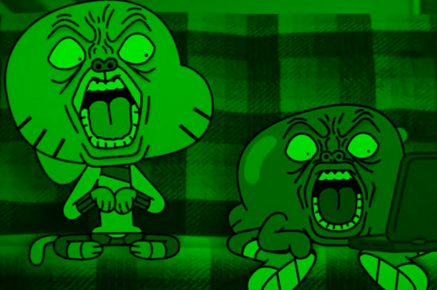

## 2. Échanger les canaux
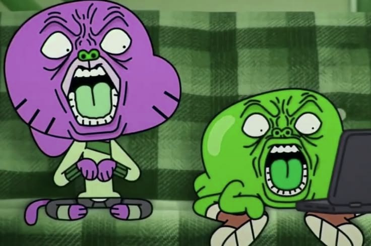

## 3. Noir et Blanc
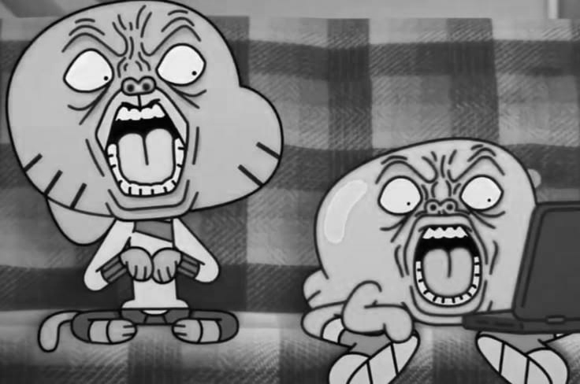

## 4. Négatif
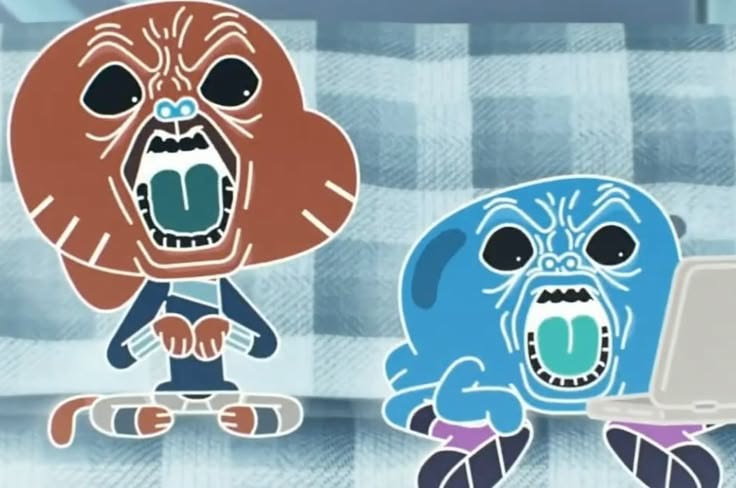

## 5. Dégradé
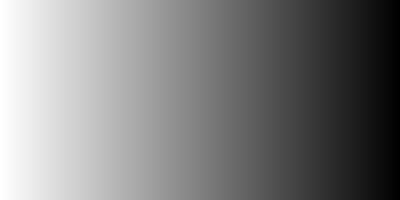
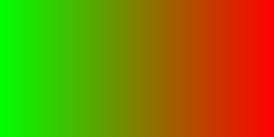

## 6. Miroir
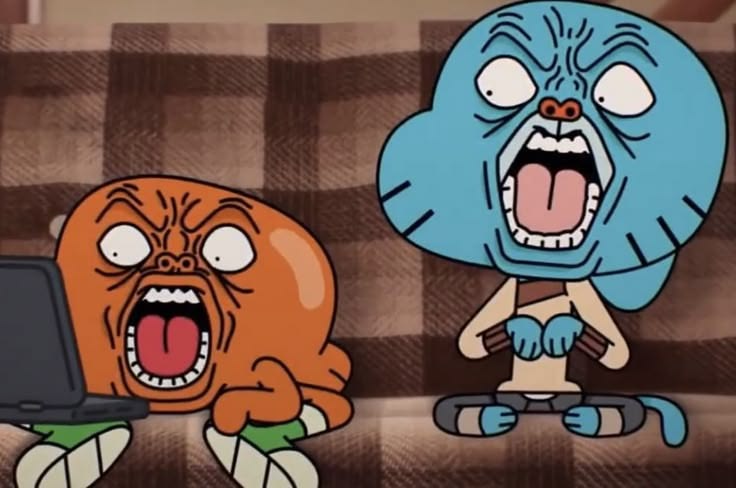

```cpp
copie.pixel(x, y) = image.pixel(image.width() - 1 - x, y);
```
Il a fallu faire attention au `-1` pour éviter que les nouveaux pixels dépassent de l'image.

```cpp
image = copie;
```
Il faut le mettre en dehors des boucles, et absolument le mettre si on travaille sur une copie, pour que dans la fonction `main` la nouvelle image soit la copie.

## 7. Image bruitée


```cpp
#include "random.hpp"
```
Librairie importante pour cet exercice et pour certains autres.

```cpp
int X = random_int(0, 4);
```
Paramètre pour déterminer si le pixel est bruité ou non : mettre la fonction entre 0 et 2 ou entre 0 et 1 rend un bruitage trop intense pour moi.

## 8. Rotation 90°
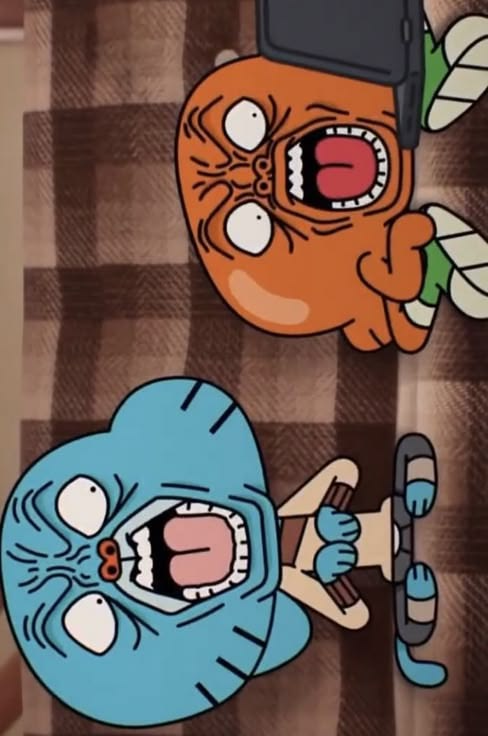

```cpp
copie.pixel(x, y) = image.pixel(y, image.height() - 1 - x);
```
Comme pour le miroir, il ne faut pas oublier le `-1`, la logique est la même sinon.

## 9. RGB split
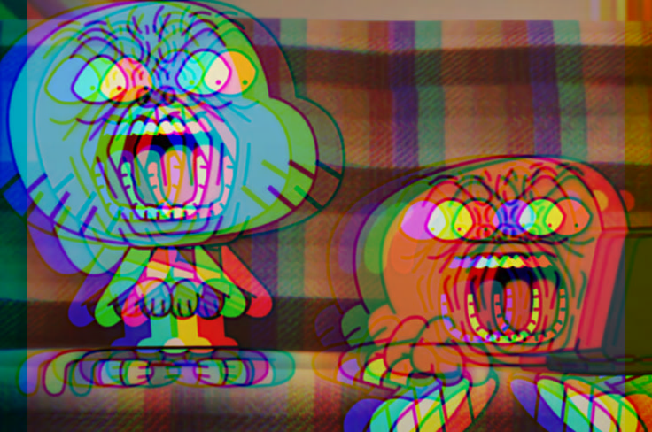

```cpp
if (image.pixel(x, y) != black)
```
Cette ligne ne sert pas à grand-chose : c'est toute l'image qui est split, pas seulement les couleurs (ce que je pensais au départ).

```cpp
sil::Image &image, int decalage
```
J'ai trouvé qu'un décalage de 30 pixels rendait plutôt bien, on reconnaît encore facilement l'image, mais j'ai ajouté une variable à la fonction pour qu'on puisse choisir le décalage.

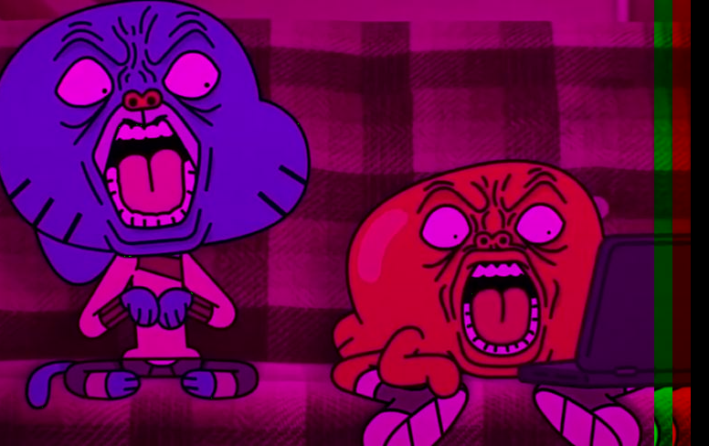
```cpp
copie.pixel(x + 20, y) = image.pixel(x, y);
copie.pixel(x - 20, y) = image.pixel(x, y);
copie.pixel(x, y) = image.pixel(x, y);

copie.pixel(x + 20, y).b = 0.f;
copie.pixel(x + 20, y).g = 0.f;
copie.pixel(x - 20, y).g = 0.f;
copie.pixel(x - 5, y).r = 0.f;
copie.pixel(x, y).b = 0.f;
copie.pixel(x, y).r = 0.f;
```
Pour mon premier essai, je repassais à chaque fois sur les autres pixels donc on ne voyait pas l'image en transparence. Il a fallu que je réécrive un programme qui prend en compte les bonnes images sans réécrire sur les pixels précédemment changés.

```cpp
sil::Image split_h(sil::Image &image, int decalage)
```
J'ai aussi fait la même fonction, mais en décalant par rapport à la hauteur et non à la largeur. 

## 10. Luminosité
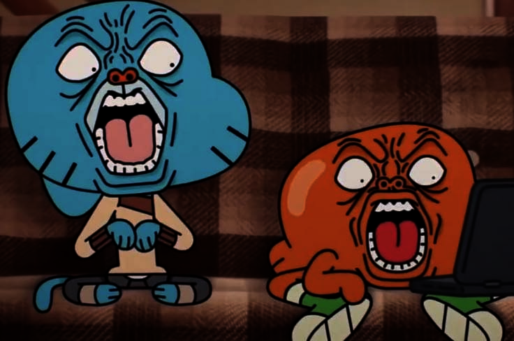

```cpp
std::pow(a, 2);
```
Pour baisser la luminosité, il a fallu inclure la fonction pour faire des calculs avec des puissances, ici des puissances de 2, afin de conserver les pixels complètement noirs et ceux complètement blancs.

```cpp
float aug(glm::vec3 color)
float aug2(glm::vec3 color)
float aug3(glm::vec3 color)
```
J'ai écrit trois fonctions pour mettre au carré chaque couleur (rouge, vert et bleu) pour ensuite changer la luminosité des pixels.

## 11. Disque
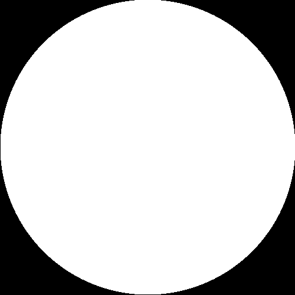

Au départ, j'ai voulu analyser chaque ligne et augmenter le nombre de pixels par ligne pour faire un disque, mais je n'ai réussi qu'à avoir un losange.

```cpp
(pow(x - centre_x, 2) + pow(y - centre_y, 2) < pow(rayon, 2))
```
Il faut donc utiliser le théorème de Pythagore pour que, pour chaque pixel, on détermine s'il est inclus dans le cercle grâce au rayon.

## 12. Cercle
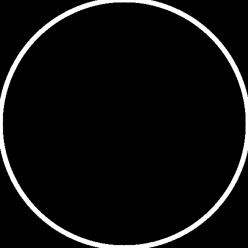

```cpp
(pow(x - centre_x, 2) + pow(y - centre_y, 2) < pow(rayon + 5, 2)) 
&& (pow(x - centre_x, 2) + pow(y - centre_y, 2) > pow(rayon - 5, 2))
```
C'est la même idée que le disque, sauf qu'il faut définir une condition en plus. J'ai choisi une épaisseur de 5 pixels.

## 13. Animation
```cpp
for (int r = 0; r < 19; r++)
{
    centre_x = centre_x + 25;
    gif(image, centre_x, centre_y, rayon);
    std::string nomfichier = std::to_string(r);
    image.save("output/gif/" + nomfichier + ".png");
}
```
Pour l'animation, la difficulté était de créer une nouvelle image sans écraser la précédente. J'avais au départ un nom de fichier avec 20 caractères (correspondant aux 20 images que je souhaitais) et, en lançant le programme, pour chaque nouvelle image créée, un des caractères du nom du fichier s'effaçait, ce qui créait une nouvelle image. Avec ce nouveau programme, on utilise la boucle pour avoir des noms de fichiers qui se suivent sans avoir les aléas de la méthode précédente.

## 14. Rosace
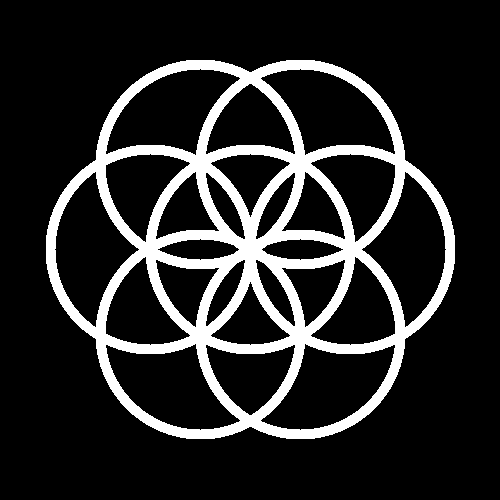

Dans un premier temps, pour la rosace, je définissais la position de chaque cercle un peu au hasard de façon à ce que leurs positions forment une rosace convenable.

```cpp
for (float angle = 0; angle < 2 * pi; angle += 2 * pi / 6)
```
En retravaillant le programme pour qu'il fonctionne pour plusieurs rayons ou pour un nombre de cercles plus élevé, j'ai utilisé cette boucle qui avance le centre de chaque cercle de $\frac{\pi}{6}$ (ou $\frac{2\pi}{6}$) à chaque tour, ce qui donne une rosace plus convenable.

## 15. Mosaïque
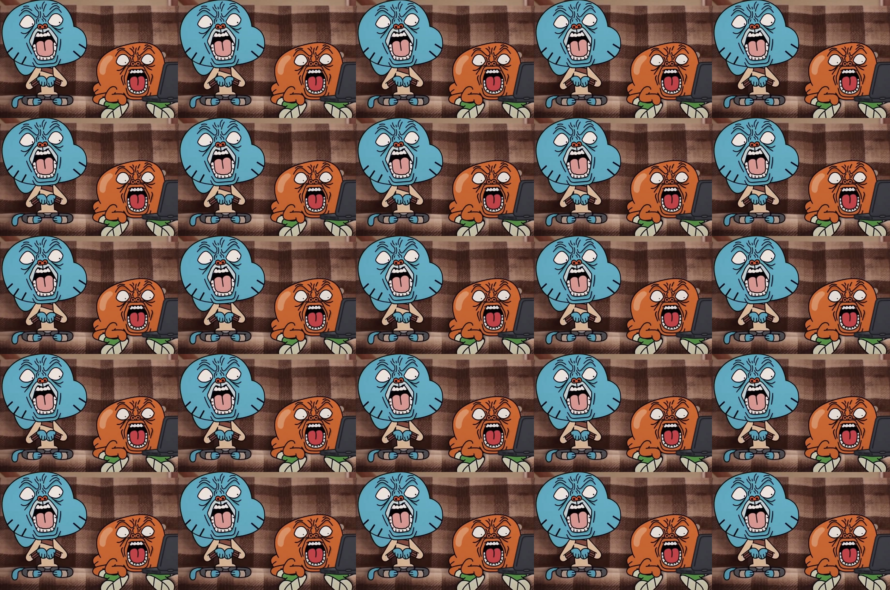

## 16. Mosaïque miroir
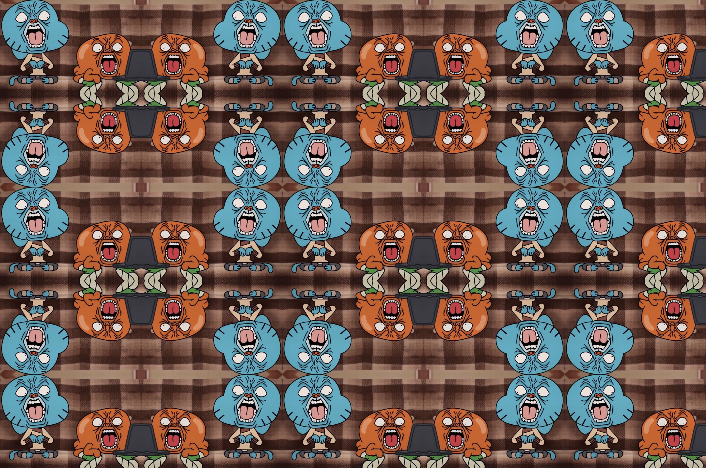
Dans un premier temps, j'avais fait 4 boucles imbriquées ; en optimisant le programme, j'ai juste eu besoin de mettre des conditions de parité.

## 17. Glitch
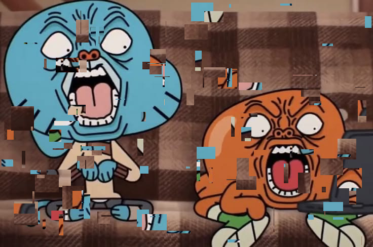
```cpp
for (int a{0}; a < W; a++)
        {
            for (int b{0}; b < H; b++)
            {}}
```
Pour ce filtre, je pensais passer par des *pixels swaps*, mais je me suis rendue compte qu'en parcourant les pixels des rectangles comme on parcourt une image, c'était plus efficace.

## 18. Tri pixel
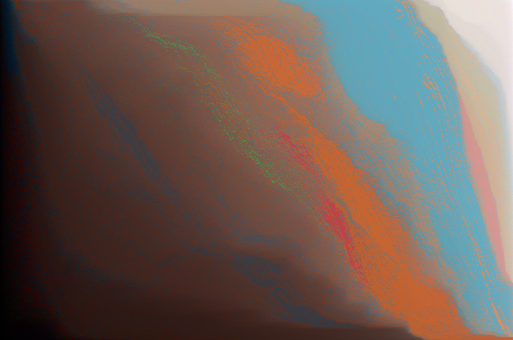
Pour ce filtre, j'ai 2 fonctions : une qui trie les pixels selon leur luminosité en fonction de la longueur et une autre en fonction de la hauteur. C'est pour cette raison que les pixels sont triés en diagonale.

## 19. Fractale de Mandelbrot
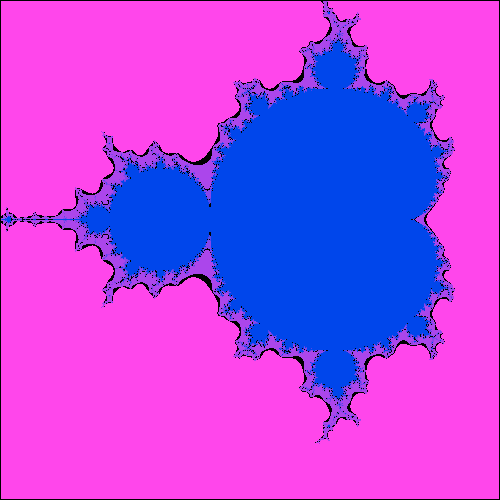
```cpp
#include <complex>
```
Pour la fractale, j'ai dû inclure une librairie pour utiliser les complexes.
```cpp
if (repetition > 50)
                    {
                        image.pixel(x, y) = glm::vec3{0, 0, 0};
                    }
                    else if (repetition > 30 && repetition < 40)
                    {
                        image.pixel(x, y) = glm::vec3{0, 0, 0};
                    }
                    else if (repetition > 20 && repetition < 30)
                    {
                        image.pixel(x, y) = glm::vec3{0, 0, 0};
                    }
                    else if (repetition > 10 && repetition < 20)
                    {
                        image.pixel(x, y) = glm::vec3{0, 0, 0};
                    }
                    else if (repetition < 10)
                    {
                        image.pixel(x, y) = glm::vec3{0, 0, 0};
                    }
```
Pour les différentes échelles de couleur, j'ai essayé de faire un contour plus net d'une autre couleur, ce qui donne cet effet un peu différent.

## 20. Vortex
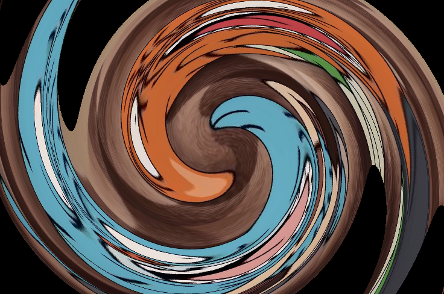
Pour le vortex, j'ai voulu faire en sorte que plus les pixels sont loin du centre, moins la rotation est puissante, comme dans la vraie vie. J'ai donc utilisé l'inverse de la fonction exponentielle :
$$ 
angle \times \exp(-distance / x)
$$
avec $x > 100$ pour que l'effet fonctionne.
```cpp
 rotated(position, centre_of_rotation, -coulee);
 ```
Pour qu'il n'y ait pas de trous noirs, puisqu'un seul pixel peut en devenir plusieurs après la rotation, on part du pixel après sa rotation puis on regarde de quelle couleur était le pixel de l'image d'origine. 

## 21. Vortex inverse
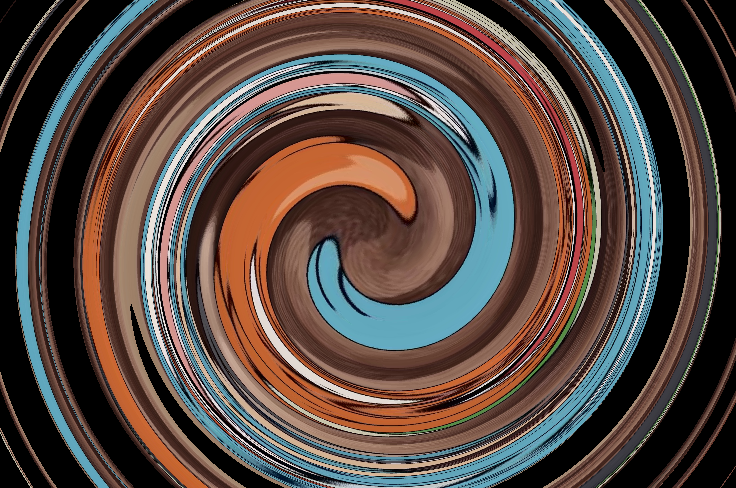
Même logique, sans la formule, pour avoir une rotation réaliste.

## 22. Convolution
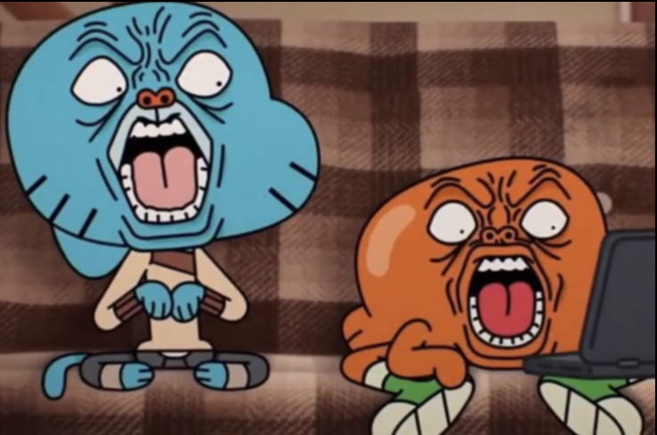
```cpp
int x{1}; x < image.width() - 1; x++
```
Pour cet exercice, il fallait faire attention à bien démarrer écarté du bord de l'image, puis dans les pixels qu'on choisit de prendre dans la matrice, bien passer par le bord de l'image. Cela permet d'éviter de rajouter des `if` et des `else`.

## 23. Convolution nette
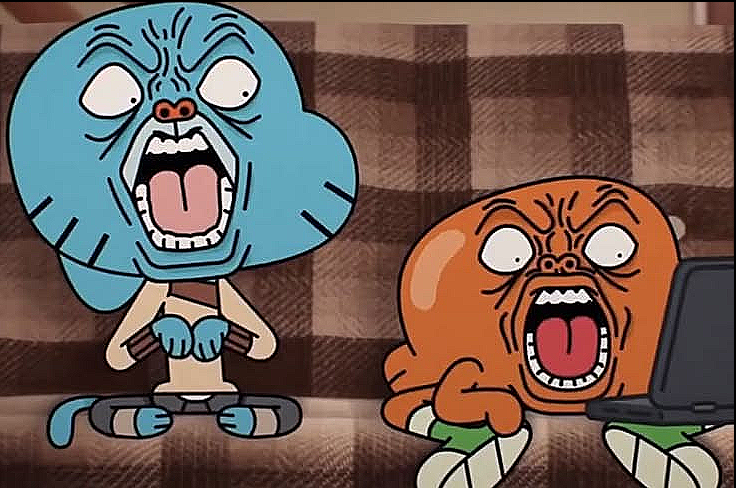
Même logique qu'avant, sauf qu'on change les valeurs pour la matrice afin de faire en sorte que le pixel au centre soit le plus puissant.

## 24. K-means
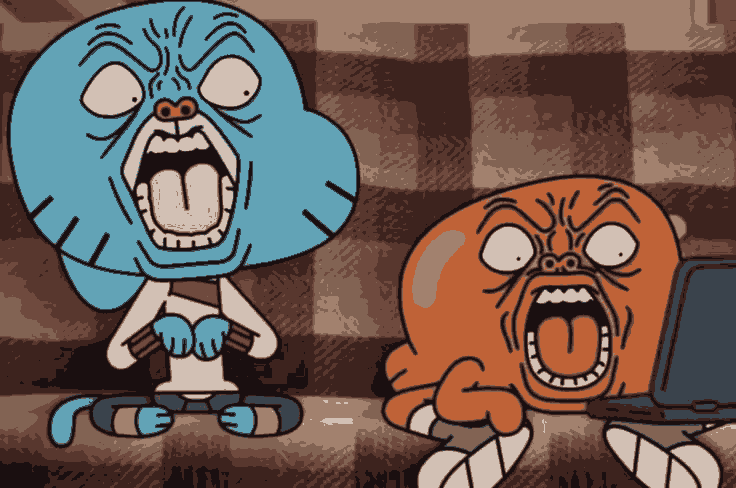

---
```cpp
for (int a{0}; a < 5; a++)
```
Pour l'exercice de k-means, j'ai pris 10 (ou autre) pixels de départ de façon aléatoire, donc parfois le résultat n'est pas optimal. Avec 10 couleurs, on a une image qui est proche de celle de départ, mais si on met moins de couleurs, à chaque fois qu'on lance le programme, il pourra y avoir de grosses différences. 
```cpp
std::vector<std::vector<glm::vec3>> groupes(nb_couleurs);
```
C'est un exercice qui m'a vraiment aidée à optimiser mes algorithmes. Pour la création des groupes de couleurs par exemple, je créais indépendamment les 10 groupes différents avant de faire un tableau qui contient lui-même 10 tableaux. Cette optimisation m'a aussi permis de pouvoir gérer plus facilement le nombre de couleurs que je souhaitais en appliquant la fonction.  

---

# Projet personnel

## 1. Compatibilité image avec K-means
Je n'ai pas d'images pour ce projet car, en appliquant la fonction, le terminal renvoie un pourcentage de compatibilité entre les images. C'est cette partie de la fonction `main` qu'il faut exécuter pour voir l'effet de la fonction.  

```cpp
{
        sil::Image image{"images/logo.jpg"};
        sil::Image image2{"images/Gumball and Darwin.jpg"};
        std::cout << kmeans_compatibilite(kmeans_compatibilite_calcul(image), kmeans_compatibilite_calcul(image2)) << std::endl;
        ;
    }
```
J'ai décidé, une fois que les deux images ont été analysées par k-means, de repasser sur toute l'image pour ranger les différents pixels suivant leur groupe de couleur. En réalité, c'est refaire ce que la fonction K-means avait déjà fait. J'aurais pu modifier la fonction K-means pour qu'elle renvoie les groupes par couleur, mais j'ai décidé de faire une fonction indépendante. 

Pour le calcul, je prends chaque groupe et sa couleur, j'additionne chaque composante RGB de la couleur (pondérée par 1, 2 et 4 respectivement pour que chaque couleur ait une valeur différente — un bleu pur est différent d'un vert pur pour nous). Je prends la taille du tableau qui représente le groupe et la multiplie par le calcul de couleur. Je répète l'opération pour chaque tableau en additionnant tout à la fin, puis je divise le tout par le nombre de pixels de l'image (pour que deux images de taille différente aient un pourcentage représentatif équivalent). Enfin, j'applique le dernier calcul pour évaluer la différence entre les deux images et la retranscrire en pourcentage. 

Pour des calculs comme celui-ci, j'ai dû faire attention aux types de variables : il fallait qu'ils soient tous en `float` pour éviter des arrondis ou conversions indésirables.

## 2. Coulée floue
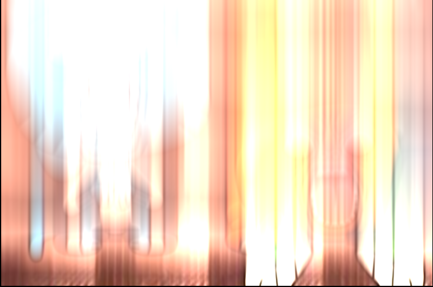
```cpp
 glm::vec3 moyenne = calcul_distance(tableau_cube);
 ```
Pour cet effet, je voulais faire la convolution à la base, mais je me suis dit qu'au lieu de partir des matrices avec des indices différents, je pouvais faire la moyenne des couleurs. Puisque le premier pixel quand on balaye toute l'image est en bas à droite, plus on monte, plus l'image est floue. On pourrait orienter le flou différemment. 

 ```cpp
 sil::Image &image, int taille
```
J'ai rajouté ce paramètre pour dupliquer l'effet sur plusieurs zones de l'image, pour éviter que tout soit flou. On retrouve cet effet dans le mélange de filtres. 

## 3. Mélange de filtres 
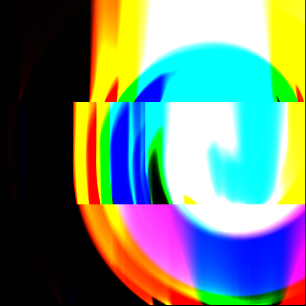
```cpp
{
        sil::Image image1{500 /*width*/, 500 /*height*/};
        sil::Image image{"images/Gumball and Darwin.jpg"}; // Lis l'image
        image1 = fractale(image1);
        image1 = split_h(image1, 150);
        image1 = convultion(image1, 3);
        image1 = vortex_inv(image1, 4);  
        image1 = convultion(image1, 3);               // Utilise la fonction pour modifier l'image
        image1.save("output/convultion2.png"); // Sauvegarde l'image
    }
```
J'ai mélangé plusieurs filtres pour rendre cette image, je voulais voir si je pouvais faire une illustration un peu psychédélique.

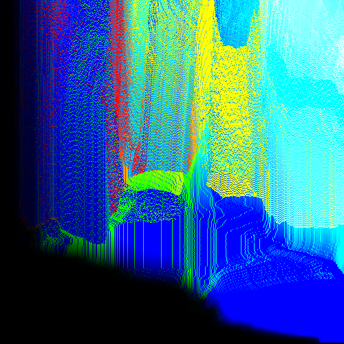
Voici un autre mélange de filtres que j'ai essayé.
```cpp
{
        sil::Image image{500, 500}; 
        sil::Image image2 = fractale(image);
        image2 = split_h(image2, 100);
        image2 = convultion(image2, 1);
        image2 = split(image2, 100);
        image2 = tri(image2);

        image2.save("output/split2.png");
    }
```